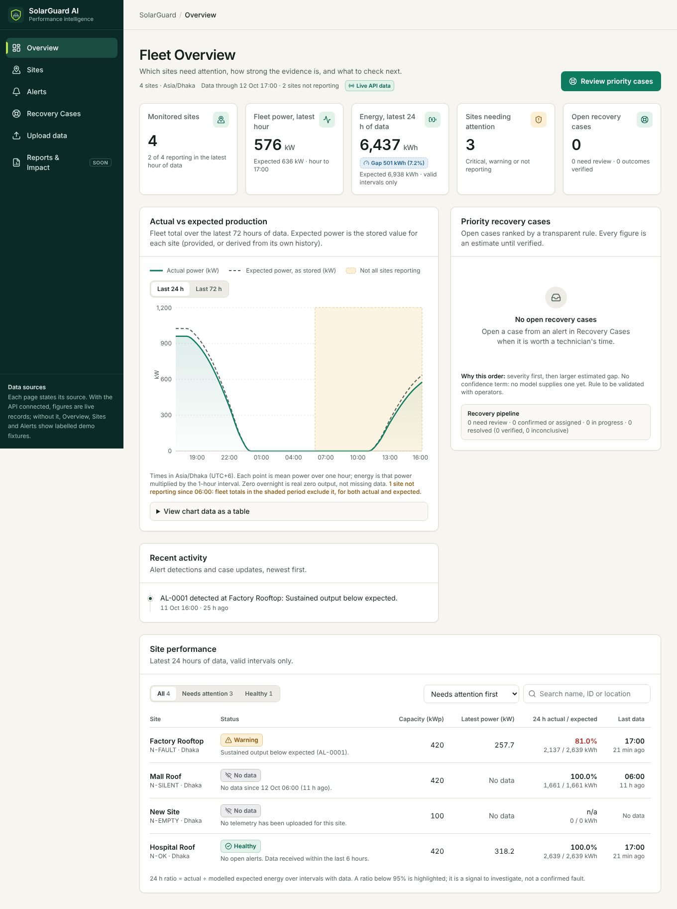
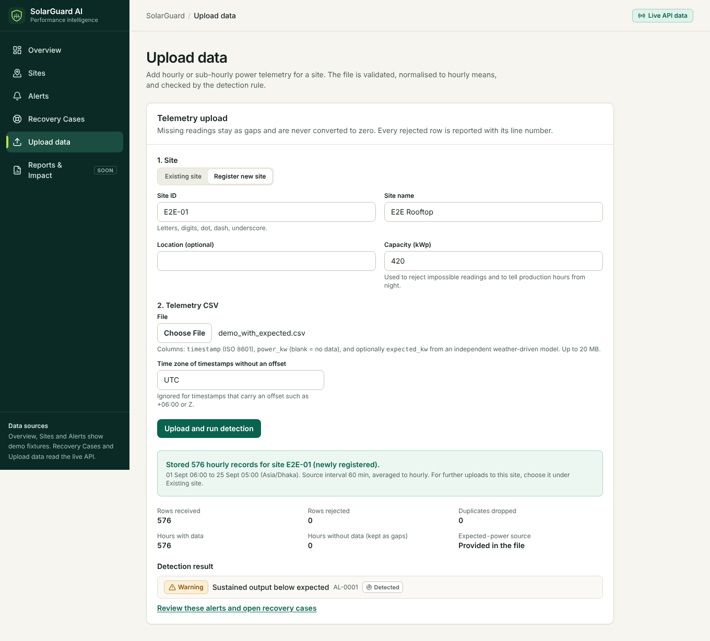
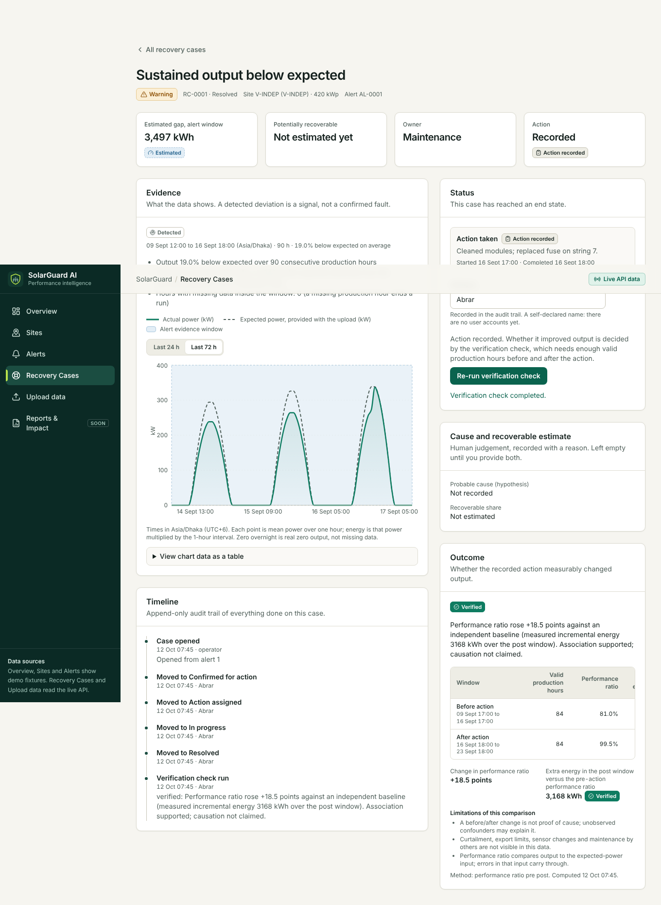
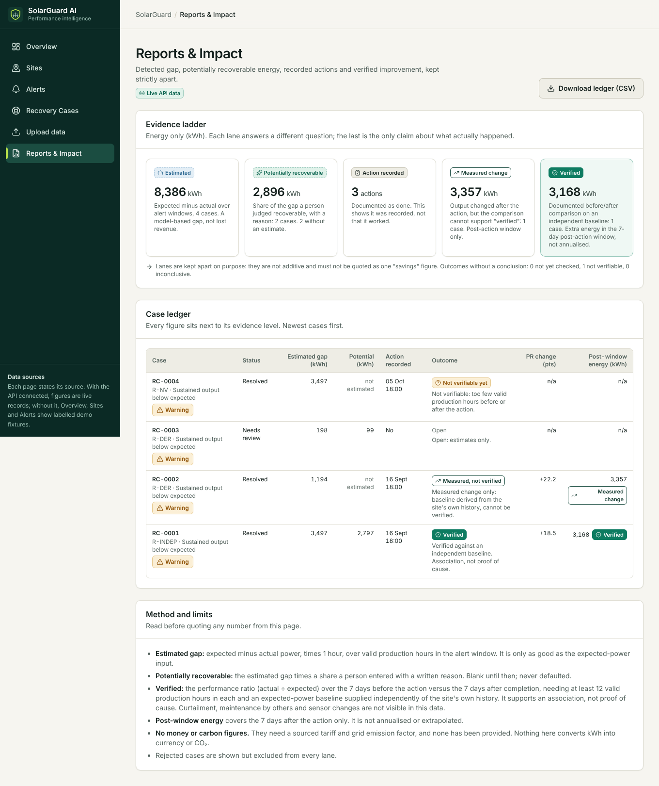
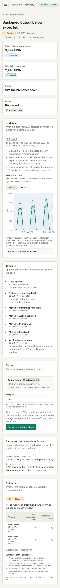
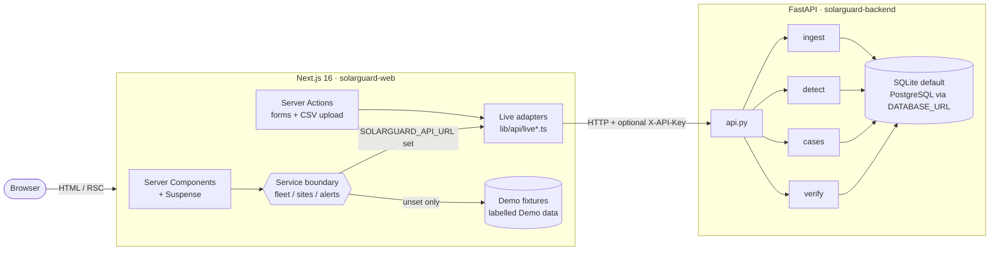

<div>
<p align="center">
  
  <br />

  <code><b>Detect</b></code> &nbsp;&bull;&nbsp;
  <code><b>Explain</b></code> &nbsp;&bull;&nbsp;
  <code><b>Prioritize</b></code> &nbsp;&bull;&nbsp;
  <code><b>Act</b></code> &nbsp;&bull;&nbsp;
  <code><b>Verify</b></code>
</p>


**A solar operations workspace that refuses to claim savings it can't prove.**

</div>

---

## 📌 Overview

Most solar monitoring tools stop at an alarm. SolarGuard AI follows a problem all the way to a **Recovery Case**: a record of what was detected, why it probably happened, what a person did about it, and whether production actually improved afterwards.

```
 Detect ──► Explain ──► Prioritize ──► Act ──► Verify
   │           │            │           │         │
 rule on     probable     severity    human     before/after
 telemetry   cause +      then gap    records   performance-ratio
 deviation   evidence                 the work  comparison
```

It is **human-in-the-loop by design**. The software proposes and measures; people confirm, act and sign off. Nothing is controlled automatically.

> ⚠️ **All data shown in the screenshots and bundled CSVs is synthetic demo data**, generated by `scripts/make_demo_csv.py`. There are no real customers, tariffs, prices or carbon figures anywhere in this repository.

---

## 🖼️ Screenshots

> Synthetic data only.

| Overview (live API) | Telemetry upload |
|---|---|
|  |  |

| A verified case | Impact ledger |
|---|---|
|  |  |

<details>
<summary>📱 Mobile view</summary>



</details>

---

## ✨ Features

| Screen | Route | What it does |
|---|---|---|
| **Overview** | `/` | Fleet status, priority cases, actual-vs-expected power chart, activity feed |
| **Sites** | `/sites`, `/sites/[id]` | Per-site status, 24 h energy, data completeness, what the data does and doesn't contain |
| **Alerts** | `/alerts`, `/alerts/[id]` | Detected deviations with evidence (open or ended); open a Recovery Case from an alert |
| **Recovery Cases** | `/recovery-cases`, `/recovery-cases/[id]` | Queue ranked by priority, full lifecycle, timeline, estimate editing, verification |
| **Upload** | `/upload` | CSV telemetry ingest with a quality report (rejected rows, duplicates, gaps, warnings) |
| **Reports** | `/reports`, `/reports/export` | Impact ledger across five separate lanes, CSV export |

**Built-in quality:** loading, empty and error states on every data page · skip link and sr-only headings · fixed `Asia/Dhaka` time formatting · mobile layout with no horizontal overflow · a visible **Live API data / Demo data** badge on every data page.

---

## 🪜 The evidence ladder

The product's core rule: **five different things are never added together, and never called by the same name.**

| # | Lane | Meaning | Source of the number |
|---|---|---|---|
| 1 | **Detected deviation** | Output fell short of expected for long enough to matter | Detection rule on telemetry |
| 2 | **Estimated gap** | kWh between expected and actual in the alert window | Arithmetic on stored data |
| 3 | **Potentially recoverable** | Share of the gap a person judges fixable | Human-entered fraction + rationale |
| 4 | **Action recorded** | What was done, by whom, when | Human-entered |
| 5 | **Measured change** | Pre/post performance-ratio comparison | Computed from telemetry |

**"Verified" is a separate, narrow status**, only reachable when *all* of these hold:

- the baseline is **independent** (supplied `expected_kw`), not derived from the site's own history,
- ≥ **12 valid production hours** exist in both the pre and post 7-day windows,
- the performance ratio improved by ≥ **3 percentage points**.

Anything else is reported honestly as **not yet verified**, **inconclusive** or **not verifiable**. A derived (trailing-median) baseline can show a *measured* improvement but can **never** reach *verified*. The ledger excludes rejected cases, never sums the lanes, and does not annualise the 7-day post-window.

---

## 🏗️ Architecture



**Decisions worth knowing**

- **No silent fallback.** If an API is configured but unreachable, pages show an error. They never quietly swap in demo data.
- **Secrets stay on the server.** `SOLARGUARD_API_URL` and `SOLARGUARD_API_KEY` are server-only; the browser never sees them or calls the API directly.
- **Request-time rendering** (`connection()`) so env and live data are never baked into a prerendered shell.
- **Forms keep your input on error** (`useServerForm`).
- **"Acting as"** is a self-declared name on actions, **not** an authenticated identity.

---

## 📁 File structure

Generated, vendored and local files (`node_modules/`, `.next/`, `.git/`, `__pycache__/`, `*.db`) are omitted.

```
solarguard-ai/
├── README.md                          ← you are here
├── docs/
│   └── screenshot/                    synthetic-data screenshots used above
│
├── solarguard-backend/                ── FastAPI service ──────────────────────
│   ├── app/
│   │   ├── main.py                    app factory, CORS, optional X-API-Key middleware
│   │   ├── api.py                     all routes (sites, alerts, cases, health)
│   │   ├── config.py                  env-driven settings
│   │   ├── db.py                      engine + session (SQLite / PostgreSQL)
│   │   ├── models.py                  SQLAlchemy models
│   │   ├── schemas.py                 pydantic request/response schemas
│   │   └── services/
│   │       ├── ingest.py              CSV parsing, hourly bucketing, quality report
│   │       ├── detect.py              rule_v1 deviation detector + alert creation
│   │       ├── cases.py               case state machine, audit events, estimates
│   │       └── verify.py              pre/post comparison + verification verdicts
│   ├── tests/                         38 pytest tests
│   │   ├── conftest.py · factories.py
│   │   ├── test_ingest.py · test_detect.py · test_cases.py
│   │   └── test_verify.py · test_auth.py · test_summary.py
│   ├── scripts/
│   │   └── make_demo_csv.py           generates synthetic demo CSVs
│   ├── data/
│   │   ├── demo_with_expected.csv     synthetic; independent baseline
│   │   └── demo_without_expected.csv  synthetic; derived baseline
│   ├── Dockerfile · docker-compose.yml   (written, never run — see Limitations)
│   ├── requirements.txt · requirements-dev.txt
│   ├── .env.example · .gitignore
│   └── README.md
│
└── solarguard-web/                    ── Next.js app ─────────────────────────
    ├── src/
    │   ├── app/                       routes (App Router)
    │   │   ├── layout.tsx · loading.tsx · error.tsx · not-found.tsx
    │   │   ├── globals.css            Tailwind v4 @theme design tokens
    │   │   ├── page.tsx               Overview
    │   │   ├── sites/                 page.tsx · [id]/page.tsx
    │   │   ├── alerts/                page.tsx · [id]/page.tsx
    │   │   ├── recovery-cases/        page.tsx · actions.ts · [id]/page.tsx
    │   │   ├── upload/                page.tsx · actions.ts
    │   │   └── reports/               page.tsx · export/route.ts (CSV)
    │   ├── components/
    │   │   ├── ui/                    Panel · MetricCard · StatusChip · ImpactStatusLabel
    │   │   │                          VerificationLabel · ConfidenceIndicator · States
    │   │   │                          PageHeader · Form · RetryButton · SourceBadge
    │   │   │                          StaleDataNotice
    │   │   ├── shell/                 AppShell · Sidebar · nav.ts
    │   │   ├── overview/              PowerChart · PriorityCases · LivePriorityCases
    │   │   │                          SitesTable · ActivityFeed
    │   │   ├── alerts/                AlertList · DemoAlertDetail · LiveAlertDetail
    │   │   ├── cases/                 CaseQueue · AlertTriage · CaseActions · CaseEstimates
    │   │   │                          CaseTimeline · VerificationPanel · UploadForm
    │   │   │                          ActorField · ApiProblem
    │   │   └── reports/               EvidenceLadder · LedgerTable
    │   └── lib/
    │       ├── domain.ts              types, energy summaries, priority comparison
    │       ├── ledger.ts · csv.ts     impact ledger; CSV export with formula-injection guard
    │       ├── format.ts · labels.ts  Asia/Dhaka formatting; status wording
    │       ├── fixtures.ts            labelled demo data
    │       ├── view.ts · action-state.ts · use-server-form.ts
    │       ├── api/
    │       │   ├── client.ts          server-only fetch, typed errors, env reading
    │       │   ├── types.ts           wire types matching the backend schemas
    │       │   ├── live.ts            raw API calls
    │       │   ├── live-fleet.ts      API → view-model adapters
    │       │   ├── fleet.ts · sites.ts · alerts.ts   live / demo dispatch
    │       │   └── settle.ts · action-helpers.ts
    │       └── __tests__/             13 vitest tests (domain · ledger · csv)
    ├── next.config.ts · tsconfig.json · eslint.config.mjs · vitest.config.mts
    ├── package.json · package-lock.json
    ├── .env.example · .gitignore · AGENTS.md
    └── README.md
```

---

## 🚀 Quick start

**Prerequisites:** Python 3.13, Node.js (a version supported by Next.js 16), npm.

### 1 · Backend

```bash
cd solarguard-backend
python -m venv .venv && source .venv/bin/activate
pip install -r requirements-dev.txt
cp .env.example .env                       # optional: SOLARGUARD_API_KEY, DATABASE_URL, CORS_ORIGINS
python scripts/make_demo_csv.py data       # regenerate the synthetic demo CSVs
uvicorn app.main:app --reload              # → http://localhost:8000/docs
```

### 2 · Web app

```bash
cd solarguard-web
npm install
cp .env.example .env.local                 # sets SOLARGUARD_API_URL=http://localhost:8000
npm run dev                                # → http://localhost:3000
```

### 3 · Try the loop

1. Open **Upload**, create a site, and upload `data/demo_with_expected.csv` (independent baseline).
2. Open **Alerts** → pick an alert → **Open a Recovery Case**.
3. Confirm it, assign an owner, record the action taken, mark it **resolved**.
4. Upload later telemetry for the same site, then run **Verify** on the case.
5. Check **Reports** to see the five lanes, side by side and never summed.

> Leave `SOLARGUARD_API_URL` unset to browse the clearly-labelled **Demo data** mode with no backend.

### Environment variables

| Variable | Where | Purpose |
|---|---|---|
| `SOLARGUARD_API_URL` | web (server-only) | Backend base URL. Unset = demo mode. |
| `SOLARGUARD_API_KEY` | web (server-only) | Sent as `X-API-Key`; must match the backend's `SOLARGUARD_API_KEY`. |
| `SOLARGUARD_API_KEY` | backend | Optional shared key; when set, requests must send `X-API-Key`. |
| `DATABASE_URL` | backend | Defaults to SQLite; set for PostgreSQL. |
| `CORS_ORIGINS` | backend | Allowed origins, e.g. `http://localhost:3000`. |

### Tests & checks

```bash
# backend
cd solarguard-backend && python -m pytest -q          # 38 tests

# web
cd solarguard-web
npm test                                              # 13 tests (vitest)
npx tsc --noEmit && npm run lint && npm run build
```

---

## 🔌 API reference

Interactive docs at `/docs` when the backend is running.

| Area | Endpoints |
|---|---|
| **Health** | `GET /health` |
| **Sites** | `POST /sites` · `GET /sites` · `GET /sites/summary` · `GET /sites/{id}` |
| **Telemetry** | `POST /sites/{id}/telemetry` (CSV upload) · `GET /sites/{id}/telemetry?from=&to=` |
| **Detection** | `POST /sites/{id}/detect` |
| **Alerts** | `GET /alerts` · `GET /alerts/{AL-0001}` · `POST /alerts/{id}/case` |
| **Cases** | `GET /cases?sort=priority\|newest` · `GET /cases/{RC-0001}` · `PATCH /cases/{id}` · `POST /cases/{id}/transition` · `POST /cases/{id}/verify` |

---

## 🧠 Rules at a glance

<details>
<summary><b>Detection — <code>rule_v1</code></b></summary>

- An alert needs **≥ 4 consecutive production hours** with **≥ 10 %** deviation from expected.
- Severity is **critical** if the mean deviation is **≥ 20 %**.
- Baseline is the supplied `expected_kw` (**independent**) or a trailing same-hour median (**derived**).
- Hours are bucketed in UTC.
- It is a transparent rule. There is **no** ML anomaly score or confidence figure.

</details>

<details>
<summary><b>Recovery Case lifecycle</b></summary>

```
needs_review ─► confirmed ─► action_assigned ─► in_progress ─► resolved
      ├────────► rejected
      └────────► inconclusive
```

Every transition is recorded as a timestamped event with the declared actor. Rejected cases are excluded from the ledger.

</details>

<details>
<summary><b>Verification</b></summary>

- Compares the **7-day pre-action** window with the **7-day post-action** window on performance ratio (actual ÷ expected).
- Requires ≥ 12 valid production hours in each window and ≥ 3 points improvement.
- Derived baselines cap at *measured*; only an independent baseline can be *verified*.
- Every result carries its method, both windows and a list of limitations.

</details>

<details>
<summary><b>Priority ranking</b></summary>

- **Live:** severity, then estimated gap.
- **Demo fixtures:** confidence × recoverable. (Differs from live by design; demo fixtures carry illustrative confidence values.)

</details>

---

## 🛡️ Truthfulness rules

1. **Never invent** savings, results, customers, prices or carbon figures. No tariff or carbon number appears without a sourced input, and none exist yet.
2. **"Verified"** appears only where a documented comparison supports it.
3. **Demo data is always labelled** as such.
4. **Humans decide.** No automated control actions.
5. **Unknown stays unknown:** missing data is shown as "No data" or "n/a", never as 0.

---

## ⚠️ Honest limitations

This is a working, tested prototype, not a hardened production system.

- **Docker / Compose / PostgreSQL were written but never run.** SQLite is what was tested.
- **No authentication or roles.** The optional `X-API-Key` is a shared secret; "Acting as" is self-declared. There is no tenant isolation.
- **No database migrations**; tables are created at startup.
- **End-to-end browser checks were run with throwaway Playwright scripts that are not committed**, so the repo contains unit/API tests only.
- Unknown ids return HTTP 200 with the not-found UI.
- Live pages make **one telemetry call per site**; a server-side fleet summary would scale better.
- Hours are bucketed in **UTC**; display is fixed to **Asia/Dhaka**.
- No anomaly model, no tariff, no carbon accounting.
- Post-window energy covers 7 days and is **not annualised**.

---

## 🗺️ Roadmap

- [ ] Authentication, roles and tenant isolation
- [ ] Alembic migrations
- [ ] Committed Playwright end-to-end suite and CI
- [ ] Validate Docker / PostgreSQL deployment
- [ ] Server-side fleet summary endpoint
- [ ] Optional anomaly model, kept clearly separate from the rule-based detector
- [ ] Sourced tariff and carbon inputs (only with documented sources)

---

## 👤 Author

**Abrar Hossain Zahin**, Data Science student, East West University, Bangladesh.

## 📄 License

Not yet chosen. Add a `LICENSE` file before publishing if you want others to reuse the code.
